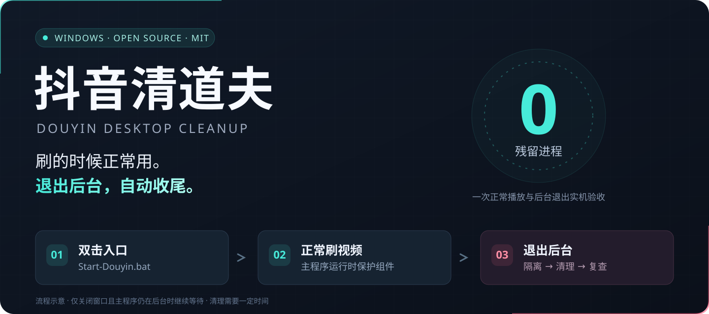
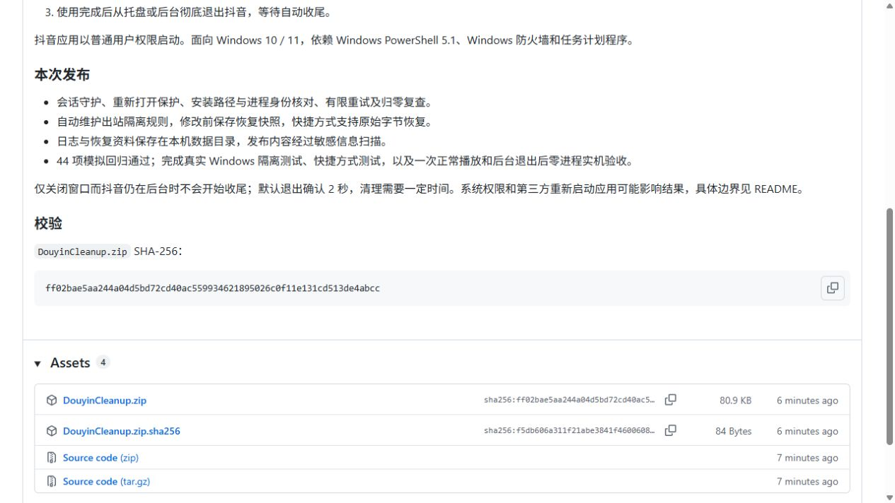
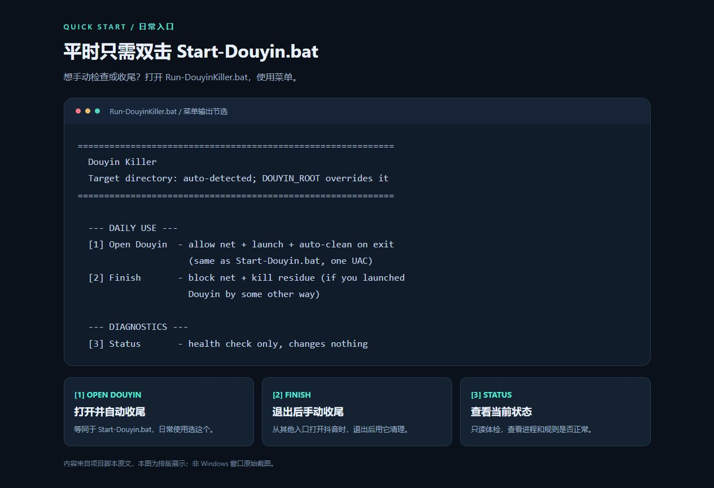
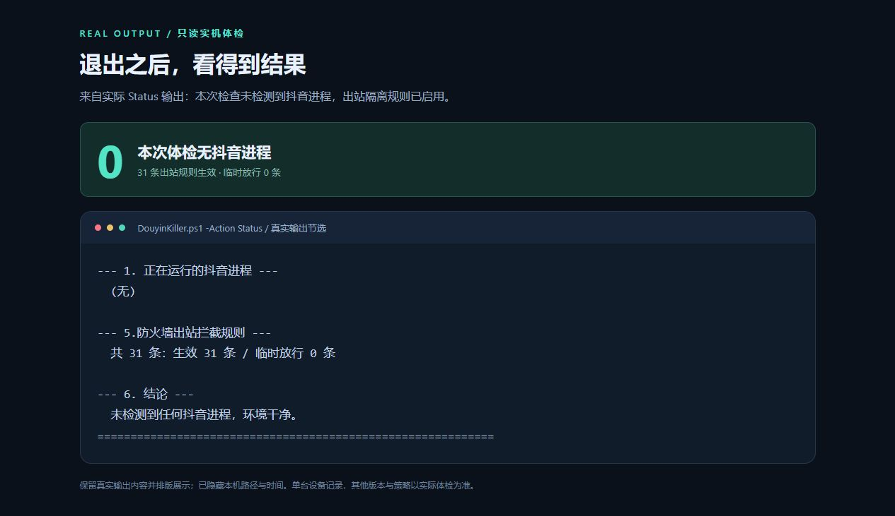

# 抖音清道夫 · Douyin Desktop Cleanup

  
  

  
  
  
  

**一个给 Windows 抖音电脑版用的后台清理工具：正常用抖音，退出后台后自动隔离网络、清理残留并复查。**

免去每次打开任务管理器手动收尾。抖音主程序还在运行时，工具会等待；重新打开时，也会保护新的会话。

*A Windows PowerShell tool for Douyin desktop: use normally, then automatically clean up verified leftover processes after the app fully exits from the background.*

## 🚀 三步上手

| 步骤 | 你需要做什么 |
| --- | --- |
| **① 下载并解压** | 到 [Releases](https://github.com/fate456/douyin-desktop-cleanup/releases/latest)，下载 **Assets 下的 `DouyinCleanup.zip`**，解压到固定目录。 |
| **② 双击打开** | 双击 **`Start-Douyin.bat`**，允许 UAC 提示，然后正常刷视频。 |
| **③ 退出后台** | 用完后从托盘或后台**彻底退出抖音主程序**，等待工具自动收尾。 |

> **只关闭窗口，可能还没退出后台。** 如果抖音仍在托盘运行，工具会继续等待。默认每 1 秒检查，退出确认时间为 2 秒，清理还需要一定时间。

防火墙控制需要管理员权限；**抖音本身以普通用户权限启动**。安装目录默认从注册表识别，通常无需填写路径。

<b>📦 下载位置看这里</b>

点击第一项 **`DouyinCleanup.zip`** 即可。`Source code` 是 GitHub 自动生成的源码包。

截图来自 v1.0.0 下载页；版本、大小和显示时间会随发布变化，入口文件名相同。

## 🧭 打开哪个文件？

日常只需要 **`Start-Douyin.bat`**。需要体检、手动收尾或配置时，再打开 **`Run-DouyinKiller.bat`**。

| 文件 | 用途 |
| --- | --- |
| **`Start-Douyin.bat`** | 日常启动入口，打开抖音并挂载自动收尾守护。 |
| `Run-DouyinKiller.bat` | 操作菜单：启动、体检、清理、网络控制与配置恢复。 |
| `Install-DouyinShortcut.bat` | 可选：把开始菜单的抖音入口指向本工具。项目搬家后重新安装快捷方式。 |

## ✅ 退出后，结果可以检查

菜单选择 **`[3] Status`** 可以只读体检。下面是一次实际检查的输出节选：没有检测到抖音进程，31 条出站规则全部生效。

此前完成的一次实际抖音会话验收中，使用者确认**视频播放正常、已退出后台**；随后扫描到：

| 检查项 | 实机验收结果 |
| --- | --- |
| 抖音主程序 | **0 个** |
| 安装目录内的进程 | **0 个** |
| 本工具的会话守护 | **0 个** |
| 当前出站隔离规则 | **全部恢复启用** |

可查看 [实机验收记录](artifacts/live-acceptance.json)、[44 项模拟回归](artifacts/regression.txt)、[Windows 隔离测试](artifacts/integration.json)和[快捷方式测试](artifacts/shortcut-integration.json)。GitHub Actions 会自动运行模拟回归及源码隐私检查。

图片来源：[说明与脱敏记录](docs/images/README.md)。横幅为流程示意；菜单图来自脚本原文，体检图来自真实只读输出，均为文本排版展示。下载图为真实 GitHub 页面截图。

## 🛠️ 不只是结束一个进程

| 能力 | 解决什么问题 |
| --- | --- |
| **保护正在使用的抖音** | 主程序运行时等待，避免在刷视频时清理组件。 |
| **退出后自动收尾** | 确认退出后隔离出站连接，先处理守护组件，再清理已确认的残留。 |
| **检测重新打开** | 收尾期间发现主程序重新打开，会停止清理并恢复放行。 |
| **按路径和进程身份核对** | 只处理配置的安装目录，结束前核对可执行路径与创建时间。 |
| **维护规则与保存恢复状态** | 跟随新增 exe 更新规则；修改配置前保存快照，保留首次状态。 |
| **运行资料保存在本机** | 日志、缓存、恢复资料位于 `%LOCALAPPDATA%\DouyinCleanup`，不进入源码和分享包。 |

## 💬 常见问题

<b>从原来的抖音快捷方式打开，也会自动收尾吗？</b>

自动会话守护需要通过 `Start-Douyin.bat` 或菜单 `[1]` 启动。也可以运行快捷方式安装器，把开始菜单入口接入本工具。

从其他入口打开后，先彻底退出后台，再用菜单 `[2] Finish` 手动收尾。

<b>如何禁用自启？如何恢复？</b>

在菜单执行 `Lockdown`：工具记录修改前状态，再禁用识别到的抖音自启服务和任务，并配置隔离。`Unlock` 恢复记录的配置、移除本工具的隔离，不会自动启动服务。

恢复只能依据已保存的快照；旧版本没有记录的历史原始设置无法推算。**保留本地数据目录，直到不再需要恢复。** 快捷方式可以通过安装器的 `-Revert` 参数单独恢复。

<b>识别不到安装目录怎么办？</b>

设置 `DOUYIN_ROOT` 环境变量，或给脚本传入 `-DouyinRoot` 参数。目录需要包含抖音主入口；工具拒绝磁盘根目录和宽泛的系统目录。

完整参数与命令见 [README.txt](README.txt)。

<b>支持哪些环境？有哪些边界？</b>

面向 Windows 10 / 11，依赖 Windows PowerShell 5.1、Windows 防火墙和任务计划程序。实际抖音验收来自一台 Windows 设备，不同客户端版本和系统策略仍可能影响结果。

路径不可读取、系统拒绝结束进程，或第三方重新启动应用时，工具会明确报失败或未确认。出站规则配置验证不等同于网络抓包验证。

## ⭐ 用着省心，就留一颗星

如果它让你少开一次任务管理器，欢迎点一下页面右上角的 **Star**。让更多想解决“抖音退出后后台仍有进程”的人找到这个小工具。

发现问题？到 [Issues](https://github.com/fate456/douyin-desktop-cleanup/issues) 提交系统版本、抖音版本、复现步骤和脱敏后的错误信息。欢迎贡献改进。

提交附件前，请移除用户名、本机路径、设备名、账户画面和恢复快照。

---

[下载最新版](https://github.com/fate456/douyin-desktop-cleanup/releases/latest) · [详细说明](README.txt) · [MIT License](LICENSE)

独立社区工具，与抖音官方没有关联。
